# GoXLR Studio

*[Dansk](README.md) · English*

**One app for your GoXLR or GoXLR Mini on Windows.** GoXLR Studio controls the mixer, the mic, the lighting and the profiles. It gives all of Windows an EQ (for example for your headphones), sends every app to the right channel and gives you hotkeys for everything. That way it replaces GoXLR Utility, Equalizer APO, Peace and AutoHotkey.

The app speaks English and Danish: it follows your Windows language, and you can change it under **Settings → Sprog / Language**.

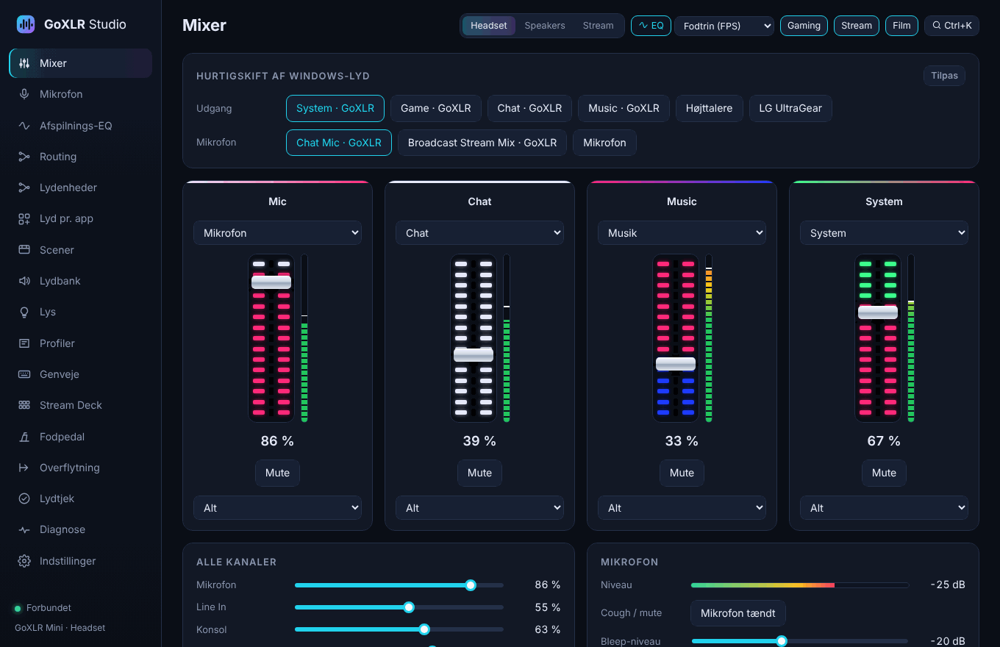

## Get it

**[⬇ Download the latest version](https://github.com/MRDonnii/goxlr-studio/releases/latest)** – pick the file ending in `x64-setup.exe`.

1. Run the installer. Windows may show "Windows protected your PC" because the app isn't code-signed: click **More info → Run anyway**.
2. Start GoXLR Studio. It finds your GoXLR by itself. The GoXLR engine is part of the app, so nothing else runs alongside it.
3. If you used other programs before, open the **Migration** page. It brings over your hotkeys, EQ presets and profiles, takes a backup and helps you uninstall the old programs.

Requirements: Windows 10/11 and TC-Helicon's USB driver for the GoXLR. The driver comes with TC-Helicon's app or can be downloaded from TC-Helicon. It makes the GoXLR a sound card in Windows and must stay installed.

The app updates itself when a new version is out.

## What is GoXLR Studio?

The GoXLR is a mixer from TC-Helicon. To control it from Windows you normally use TC-Helicon's app or GoXLR Utility. If you also want EQ on your headphones, per-app audio or keys to switch profiles, Equalizer APO, Peace and AutoHotkey come on top. GoXLR Studio puts it all into one app:

- **The GoXLR engine is built in.** The part that talks to the GoXLR over USB comes from the open source project GoXLR Utility and runs inside GoXLR Studio. Your profiles and settings from GoXLR Utility keep working.
- **The EQ engine is built in.** The playback EQ uses Equalizer APO's audio engine, which GoXLR Studio installs, tests and controls itself. You don't need Equalizer APO or Peace.
- **Only TC-Helicon's USB driver** has to be installed next to it.

## What it does

### Mixer

The channels of your GoXLR with the same LED colors as the hardware, a level meter on each channel, mute and source selection. Below them are all the channel volumes and the mic level. At the top you switch Windows' default output and mic with one click, e.g. from GoXLR "System" to your speakers. The top bar switches GoXLR profile, EQ preset and scene.

### Playback EQ for all of Windows

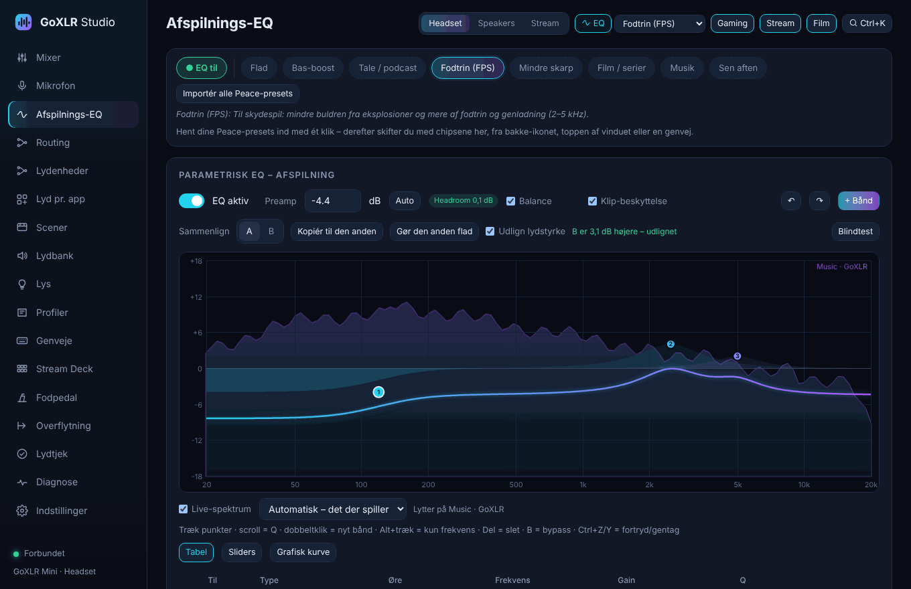

- Parametric EQ with a curve you drag, and undo/redo – or **sliders** with gain, frequency, Q and filter type per band and a preamp slider
- **Left and right ear separately**, band-pass/all-pass and steep low/high cuts (up to 48 dB/octave)
- **Live spectrum** behind the curve: see where the music or the game has its energy while you adjust the EQ
- **A/B at the same loudness:** the louder of A and B is turned down, so you hear the difference in sound and not just in volume. With the **blind test** you hear them as X and Y without knowing which is which
- **Balance:** raise a band, and the whole floor (preamp) goes down as much – balance instead of just more level
- **Clip protection and headroom:** the app calculates the whole chain (EQ, Loudness and Crossfeed) and lowers the level by itself if the sound would otherwise distort. "Auto" sets the preamp just below the limit
- Presets, including your old Peace/Equalizer APO presets, imported with one click and sounding exactly as before (GraphicEQ too)
- AutoEQ search that finds the correction for your exact headphones
- **Hearing test:** find the faintest tone you can hear in each ear and get a personal EQ for your ears and your headphones
- Crossfeed, loudness, mono and balance for headphones
- **Sounds wrong?** Pick e.g. "harsh" or "muddy", and the EQ is adjusted one small step. Export and import all presets
- **EQ per app:** e.g. Call of Duty with the footsteps EQ and Spotify with the music EQ at the same time (Per-app audio → EQ per app)
- **EQ per channel:** its own preset on Game, Music, Chat and System. Apps follow their channel, so Spotify gets the music EQ and the game the footsteps EQ – and every GoXLR profile can have its own set
- EQ that follows the GoXLR profile, e.g. one preset for "Headset" and another for "Speakers"
- Listening test in the app, so you can hear the difference with and without EQ

**The EQ engine tests itself.** Windows can put the EQ engine on an output in three ways, and which one works differs from PC to PC. After installing, GoXLR Studio opens every output and checks that the engine is actually loaded. If it isn't, it tries the other ways by itself. You can always press **Test the EQ engine** again.

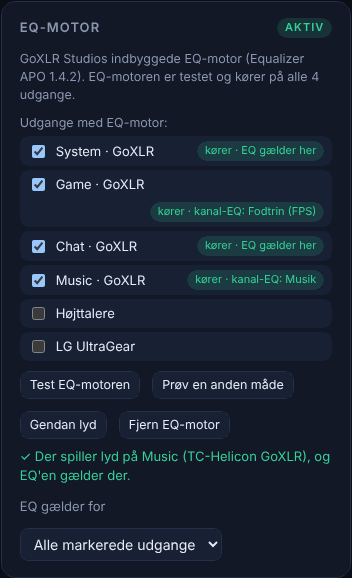

### Mic

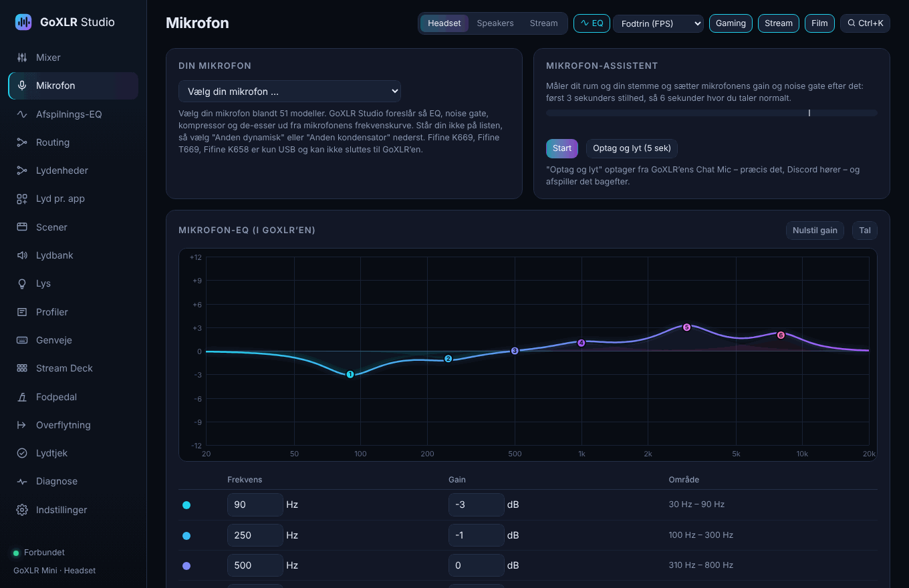

The mic EQ runs in the GoXLR's own chip, so it uses no CPU and adds no delay. Here you also find gain, noise gate, compressor and mic profiles.

**Pick your microphone** from 51 models, e.g. Røde NT1, Shure SM7B, Fifine K688 and Audio-Technica AT2020. GoXLR Studio then suggests EQ, noise gate, compressor and de-esser from the mic's frequency response: a clear speaking voice minus the mic's own coloration, fitted to the GoXLR's bands. The **mic assistant** listens to your room and your voice and sets gain and noise gate, and **Record and listen** lets you hear the result. Happy with it? **Share your settings** as a file with a friend.

### Per-app audio

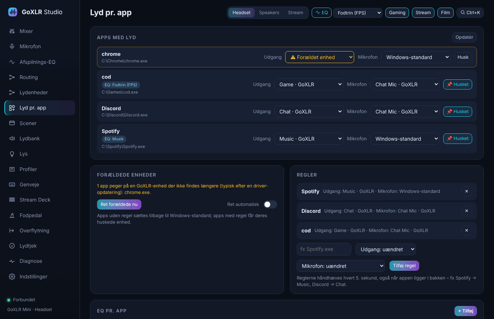

Send every app to its channel on the GoXLR, e.g. Spotify → Music, Discord → Chat and games → System. The rules are kept, also when the app restarts. Apps that point to a GoXLR device that no longer exists after a driver update are fixed. Things can also happen automatically when a certain app starts.

**Automation when a device is connected** (Audio devices page): plug in a USB or Bluetooth headset, and GoXLR Studio switches to e.g. the "Headset" profile and sends the sound to the headset. Unplug it, and it switches back to "Speakers".

### Hotkeys, command palette and on-screen messages

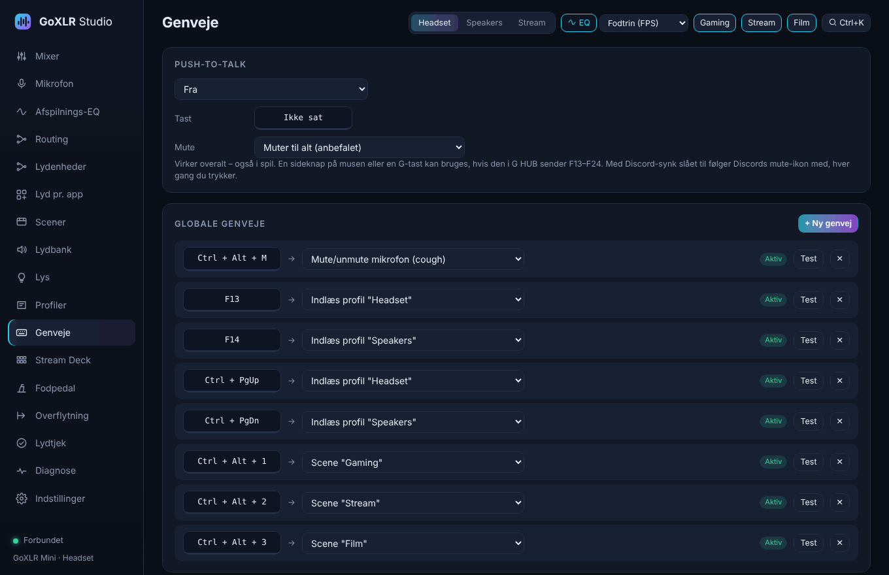

Free global hotkeys for profiles, EQ presets, scenes, mute and much more, also push-to-talk. They work in the middle of games, and G keys from Logitech G HUB can be used (F13–F24). Your old AutoHotkey hotkeys can be imported directly.

**Ctrl+K** opens a command palette where you can search for everything the app can do:

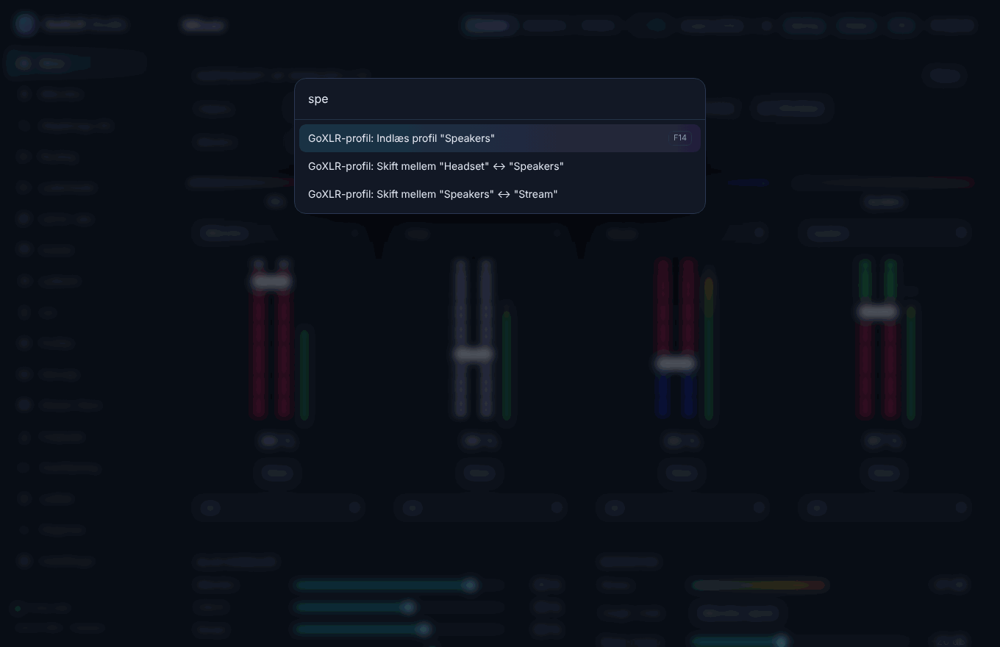

When a hotkey is used, a small box at the top of the screen shows what happened for a second, also over games. The tray icon gets a red dot when the mic is muted, and its menu can switch profile, EQ and scene.

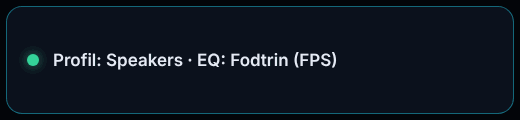

### Stream Deck

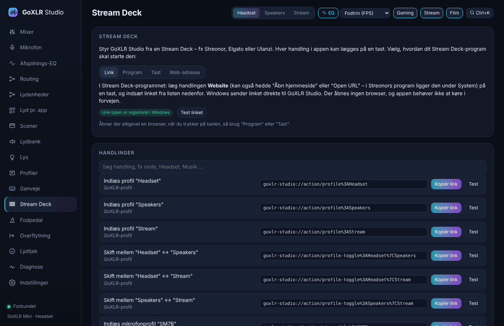

Put any action on a key of a Stream Deck, e.g. Streonor, Elgato or Ulanzi. The **Stream Deck** page lists all actions, and you copy what your Stream Deck app needs:

- a link (`goxlr-studio://action/…`) for the "Website" action
- a command for "Open program"
- a key for "Hotkey"
- a web address for the local API

The link also starts GoXLR Studio if the app isn't running.

### Foot pedal

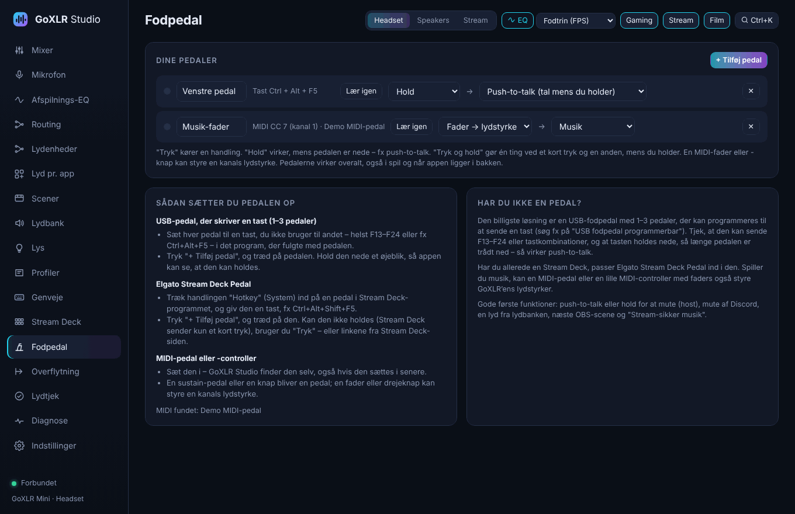

Use a foot pedal as a button – e.g. push-to-talk with your foot. USB pedals that send a key, the Elgato Stream Deck Pedal and MIDI pedals/controllers. Each pedal can run an action when pressed, work while held (push-to-talk/-mute), do two different things on a short press and a hold – and a MIDI fader can control a channel's volume. Press "+ Add pedal" and step on it.

### Soundboard

Add sounds and play them on the GoXLR's Sample channel – with the GoXLR's routing they reach Discord and your stream. Works on the GoXLR Mini too, which has no sampler of its own.

### Scenes

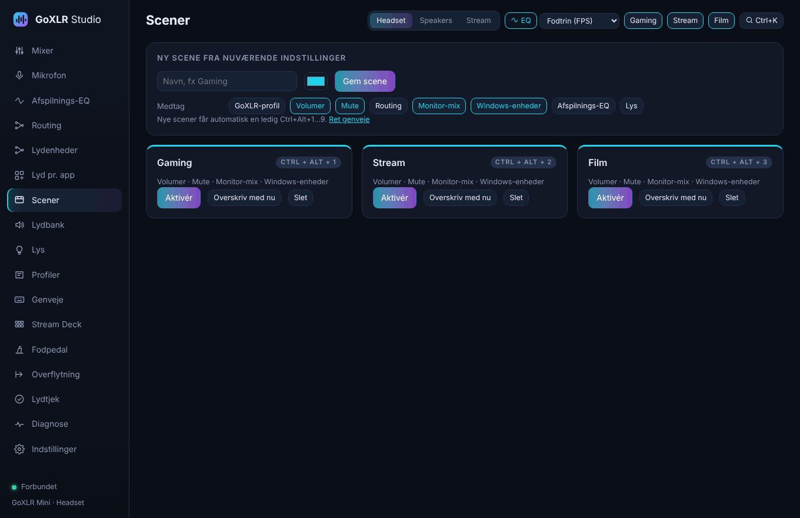

Save the whole audio setup as a scene, e.g. "Gaming", "Stream" or "Movie": volumes, mute, routing, monitor mix, Windows devices, EQ and lighting. Switch with one hotkey (Ctrl+Alt+1–9) or from the top bar.

### Lighting

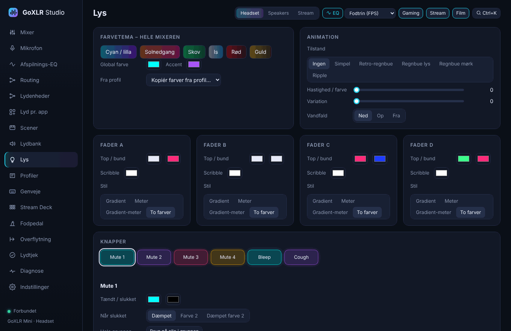

Color themes for the whole mixer, colors and style for each fader, animations and colors for all buttons.

### Routing

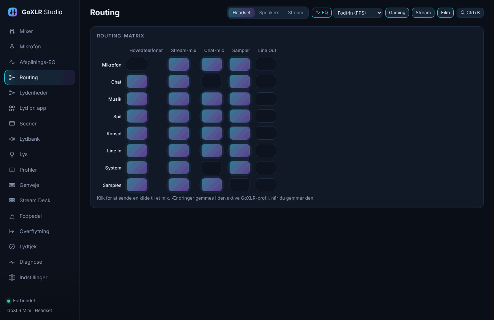

Which sources go to headphones, stream, chat mic, sampler and line out – one click per cell.

### Migration from the old programs

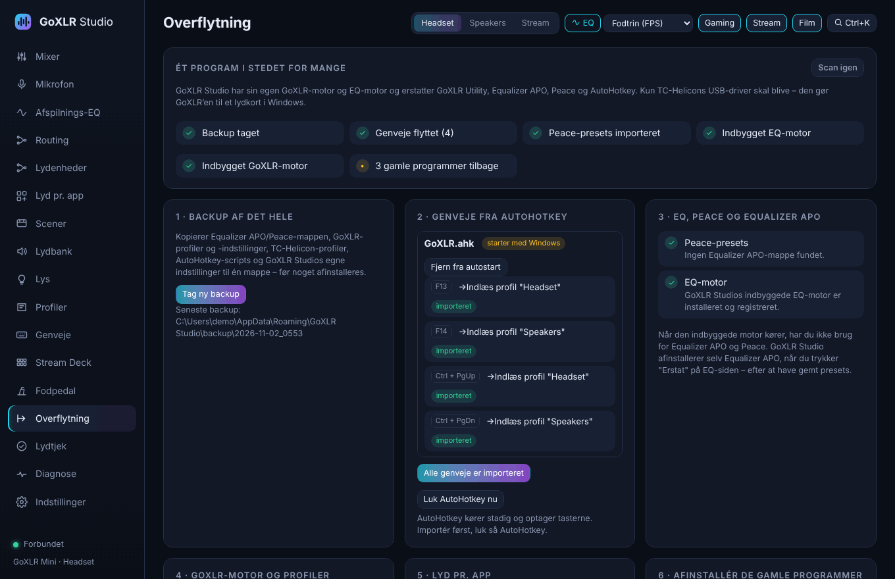

GoXLR Studio backs everything up and brings over your AutoHotkey hotkeys, Peace presets and TC-Helicon profiles. It takes over from GoXLR Utility and helps you uninstall the old programs. The driver stays.

### Settings, Discord and much more

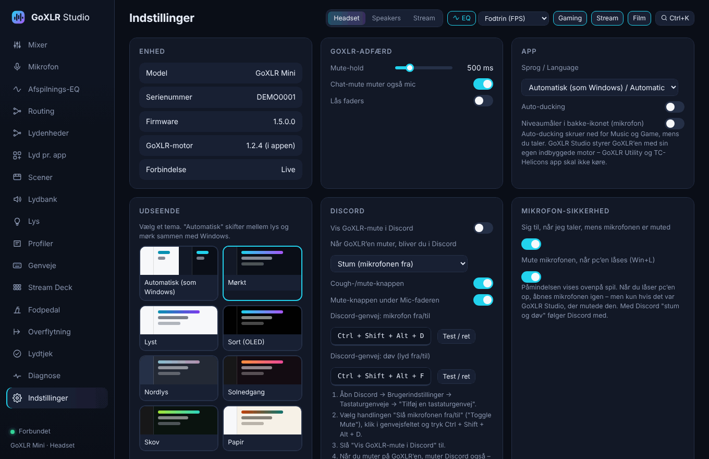

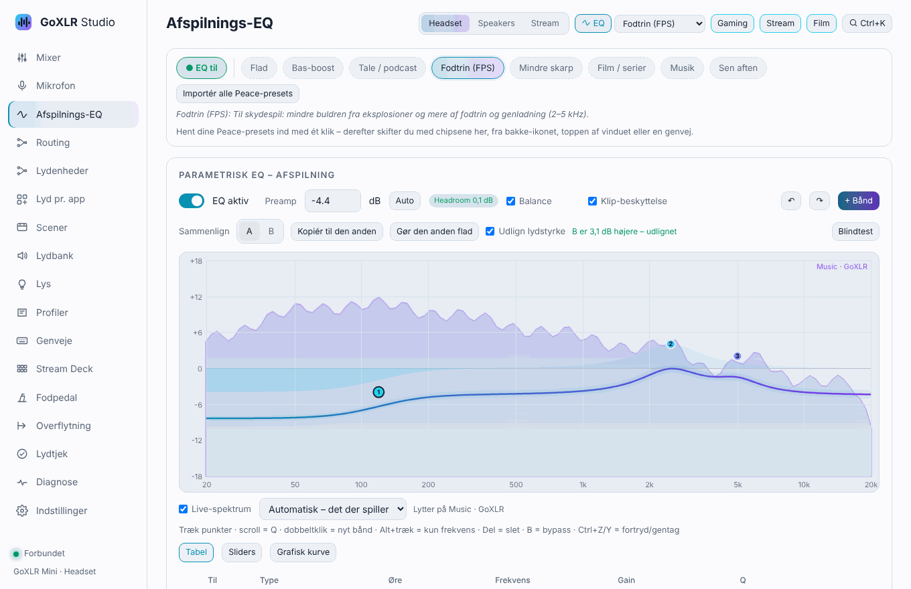

- **Discord:** the GoXLR's mute button also mutes (and can deafen) Discord, with the red icon
- **Mic safety:** a warning when you talk while muted, and the mic is muted when you lock the PC (Win+L)
- Auto-ducking that turns music and games down while you talk – or while your friends talk in Discord
- **Hearing protection:** a reminder after a long time of loud sound and an optional ceiling for the headphones
- **Profile history:** earlier versions of your GoXLR and mic profiles can be restored
- **Themes:** light, dark (or automatic like Windows), Black (OLED), Northern lights, Sunset, Forest and Paper – and an optional accent colour
- Start with Windows and close to the tray icon
- Automatic updates
- **Home Assistant** via MQTT: GoXLR Studio shows up as a device with mic mute, "Mic open" (e.g. for an ON AIR lamp), GoXLR profile, EQ preset, scene and volumes
- **OBS:** switch OBS scenes with hotkeys, Stream Deck or automation, let the scene follow the GoXLR profile, and "Stream-safe music" takes the music out of your stream
- **Remote on your phone:** mute, profiles, scenes, EQ and volume from your phone on the same Wi-Fi
- Local API, e.g. for Stream Deck
- **Sound check** that finds Windows settings that change the sound (e.g. Windows turning the game down during calls) and fixes them with one click
- Backup and a **Diagnostics** page where you can copy or save a report (without passwords) if something acts up
- Effects on the full-size GoXLR: reverb, echo, pitch, gender, megaphone, robot and hardtune

*The screenshots are taken with the app's demo data in the GoXLR Mini layout, with the Danish UI.*

## Contains

GoXLR Studio is MIT licensed. GoXLR Utility's engine (MIT) is built into the app itself, and Equalizer APO's audio engine (GPL v2) is used unchanged – see [THIRD-PARTY-NOTICES.md](THIRD-PARTY-NOTICES.md).

## Development

- UI: `public/` (vanilla JS, no build) – `STUDIO_PORT=14600 node server.js` runs it in a browser with demo data (`?mini` for the GoXLR Mini).
- The UI is written in Danish; `public/js/i18n.js` shows English from `public/js/i18n-en.js`. New texts: `python3 scripts/i18n-extract.py --missing` → translate → `python3 scripts/i18n-merge.py <file.json>`.
- GoXLR engine: `src-tauri/goxlr-engine/` (see its README), EQ engine: `src-tauri/src/engine.rs`.
- Tests: `node --test tests/*.test.mjs` and `cd src-tauri && cargo test --lib`; `cargo check --target x86_64-pc-windows-msvc` checks the Windows part.
- The Windows build runs in GitHub Actions; a new version in `src-tauri/tauri.conf.json` on `main` is released automatically.
