# GoXLR Studio

*Dansk · [English](README.en.md)*

**Ét program til din GoXLR eller GoXLR Mini på Windows.** GoXLR Studio styrer mixeren, mikrofonen, lyset og profilerne. Det giver hele Windows en EQ (fx til dine hovedtelefoner), sender hver app til den rigtige kanal og giver dig genvejstaster til det hele. Dermed erstatter det GoXLR Utility, Equalizer APO, Peace og AutoHotkey.

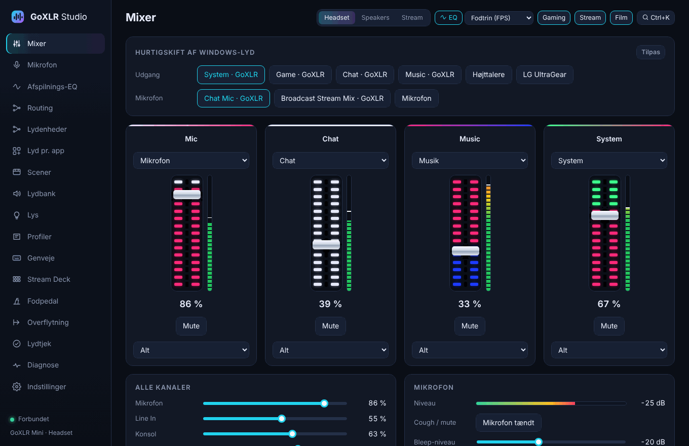

## Hent den

**[⬇ Download nyeste version](https://github.com/MRDonnii/goxlr-studio/releases/latest)** – vælg filen der ender på `x64-setup.exe`.

1. Kør installeren. Windows viser måske "Windows beskyttede din pc", fordi appen ikke er kodesigneret: klik **Flere oplysninger → Kør alligevel**.
2. Start GoXLR Studio. Den finder selv din GoXLR. GoXLR-motoren er en del af appen, så der kører ikke noget ved siden af.
3. Har du brugt andre programmer før, så åbn siden **Overflytning**. Den henter dine genveje, EQ-presets og profiler over, tager backup og hjælper dig med at afinstallere det gamle.

Krav: Windows 10/11 og TC-Helicons USB-driver til GoXLR. Driveren følger med TC-Helicons app eller kan hentes hos TC-Helicon. Den gør GoXLR'en til et lydkort i Windows og skal blive installeret.

Appen opdaterer sig selv, når der kommer en ny version.

## Hvad er GoXLR Studio?

GoXLR'en er en mixer fra TC-Helicon. For at styre den fra Windows bruger man normalt TC-Helicons app eller GoXLR Utility. Vil man også have EQ på hovedtelefonerne, lyd pr. app eller taster til profilskift, kommer Equalizer APO, Peace og AutoHotkey oveni. GoXLR Studio samler det hele i ét program:

- **GoXLR-motoren er bygget ind.** Den del, der taler med GoXLR'en over USB, kommer fra open source-projektet GoXLR Utility og kører inde i GoXLR Studio. Dine profiler og indstillinger fra GoXLR Utility virker uændret.
- **EQ-motoren er bygget ind.** Afspilnings-EQ'en bruger Equalizer APO's lydmotor, som GoXLR Studio selv installerer, tester og styrer. Du skal ikke have Equalizer APO eller Peace.
- **Kun TC-Helicons USB-driver** skal være installeret ved siden af.

## Det kan den

### Mixer

Kanalerne fra din GoXLR med samme LED-farver som på hardwaren, et VU-meter ved hver kanal, mute og valg af kilde. Under dem ligger alle kanalers lydstyrke og mikrofonens niveau. Øverst skifter du Windows' standard-udgang og -mikrofon med ét klik, fx fra GoXLR "System" til dine højttalere. Topbjælken skifter GoXLR-profil, EQ-preset og scene.

### Afspilnings-EQ for hele Windows

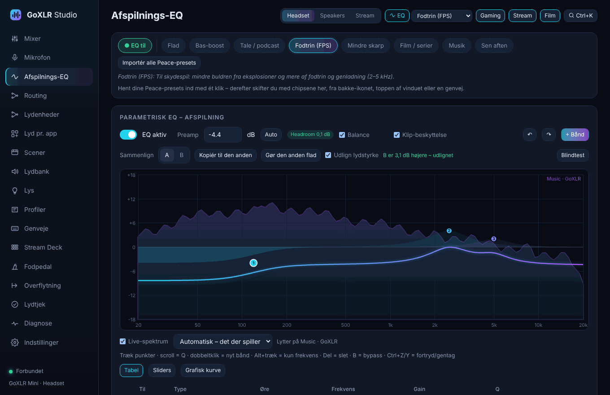

- Parametrisk EQ med en kurve, du trækker i, og fortryd/gentag
- **Live-spektrum** bag kurven: du ser, hvor musikken eller spillet har sin energi, mens du stiller på EQ'en
- **A/B ved samme lydstyrke:** den højeste af A og B sænkes, så du hører forskellen i klang og ikke bare i lydstyrke. Med **blindtest** hører du dem som X og Y uden at vide, hvilken er hvilken
- **Klip-beskyttelse og headroom:** appen regner på hele kæden (EQ, Loudness og Crossfeed) og sænker selv lyden, hvis den ellers ville forvrænge. "Auto" sætter preamp lige under grænsen
- Presets, også dine gamle Peace/Equalizer APO-presets, som importeres med ét klik
- AutoEQ-søgning, der finder korrektion til netop dine hovedtelefoner
- Crossfeed, loudness, mono og balance til hovedtelefoner
- **Lyder det forkert?** Vælg fx "skarp" eller "mudret", og EQ'en justeres et lille skridt. Eksport og import af alle presets
- EQ der skifter med GoXLR-profilen, fx ét preset til "Headset" og et andet til "Speakers"
- Lyttetest i appen, så du kan høre forskellen med og uden EQ

**EQ-motoren tester sig selv.** Windows kan sætte EQ-motoren på en udgang på tre måder, og det er forskelligt fra pc til pc, hvilken der virker. Efter installationen åbner GoXLR Studio hver udgang og tjekker, at motoren faktisk bliver indlæst. Hvis den ikke gør, prøver den selv de andre måder. Du kan altid trykke **Test EQ-motoren** igen.

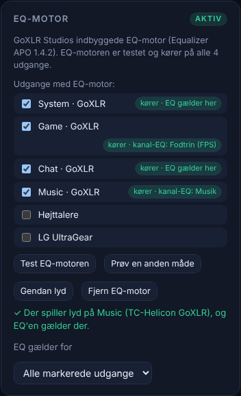

### Mikrofon

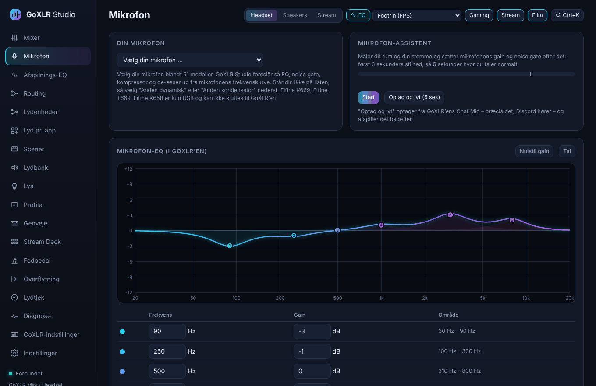

Mikrofon-EQ'en kører i GoXLR'ens egen chip, så den bruger hverken CPU eller giver forsinkelse. Her finder du også gain, noise gate, kompressor og mikrofonprofiler.

**Vælg din mikrofon** blandt 51 modeller, fx Røde NT1, Shure SM7B, Fifine K688 og Audio-Technica AT2020. GoXLR Studio foreslår så EQ, noise gate, kompressor og de-esser ud fra mikrofonens frekvenskurve. EQ'en er en klar talestemme minus mikrofonens egen klang, tilpasset GoXLR'ens bånd.

### Lyd pr. app

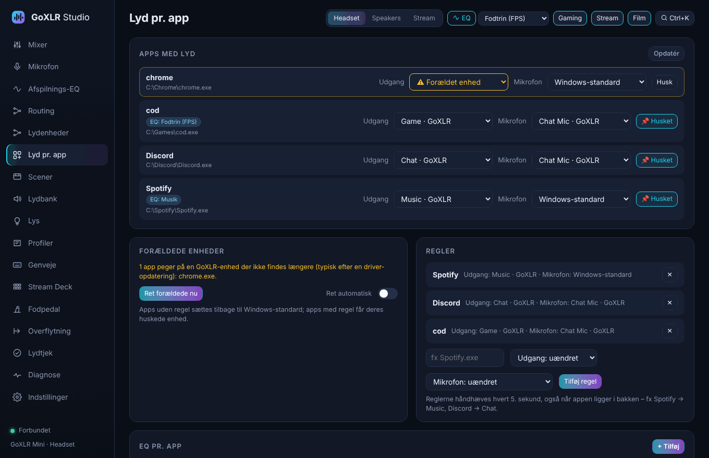

Send hver app til sin kanal på GoXLR'en, fx Spotify → Music, Discord → Chat og spil → System. Reglerne bliver holdt, også når appen genstarter. Apps, der efter en driveropdatering peger på en GoXLR-enhed, som ikke findes længere, bliver rettet. Du kan også lade ting ske automatisk, når en bestemt app starter.

**Automatik når en enhed tilsluttes** (siden Lydenheder): sæt et USB- eller Bluetooth-headset til, og GoXLR Studio skifter fx til profilen "Headset" og sender lyden til headsettet. Tag det ud, og den skifter tilbage til "Speakers". Det kan også ske, når appen starter.

### Genveje, kommandolinje og besked over spil

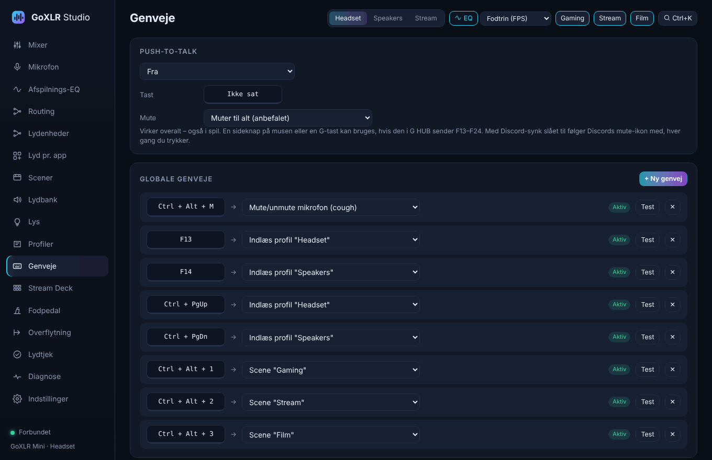

Frie globale genveje til profiler, EQ-presets, scener, mute og meget mere. De virker også midt i spil, og G-taster fra Logitech G HUB kan bruges (F13–F24). Dine gamle AutoHotkey-genveje kan hentes direkte over.

**Ctrl+K** åbner en kommandolinje, hvor du kan søge efter alt, appen kan:

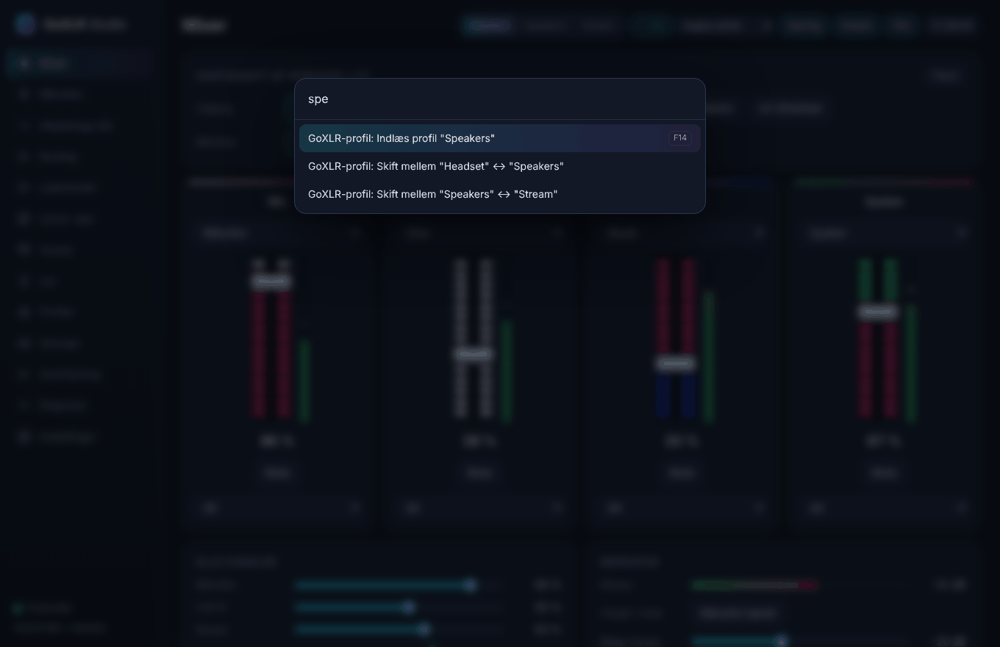

Når en genvej bruges, viser en lille boks øverst på skærmen i et sekund, hvad der skete, også over spil. Bakke-ikonet får en rød prik, når mikrofonen er muted, og dets menu kan skifte profil, EQ og scene.

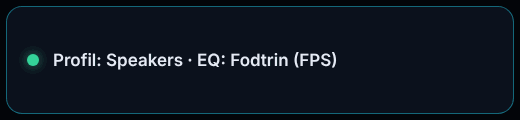

### Stream Deck

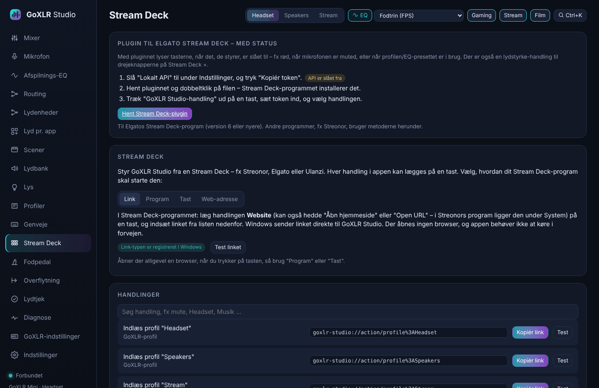

Læg enhver handling på en tast på en Stream Deck, fx Streonor, Elgato eller Ulanzi. Siden **Stream Deck** viser alle handlinger, og du kopierer det, dit Stream Deck-program skal bruge:

- et link (`goxlr-studio://action/…`) til handlingen "Website"
- en kommando til "Åbn program"
- en tast til "Hotkey"
- en web-adresse til det lokale API

Linket starter også GoXLR Studio, hvis appen ikke kører.

### Scener

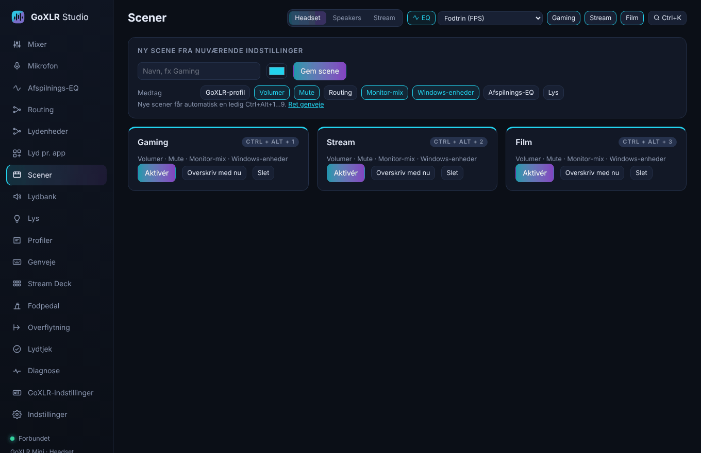

Gem hele lydopsætningen som en scene, fx "Gaming", "Stream" eller "Film": lydstyrker, mute, routing, monitor-mix, Windows-enheder, EQ og lys. Du skifter med én genvej (Ctrl+Alt+1–9) eller fra topbjælken.

### Lys

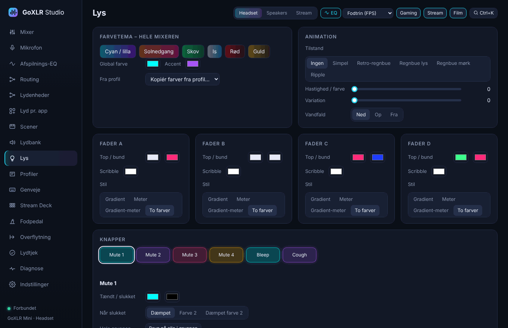

Farvetemaer til hele mixeren, farver og stil på hver fader, animationer og farver på alle knapper.

### Routing

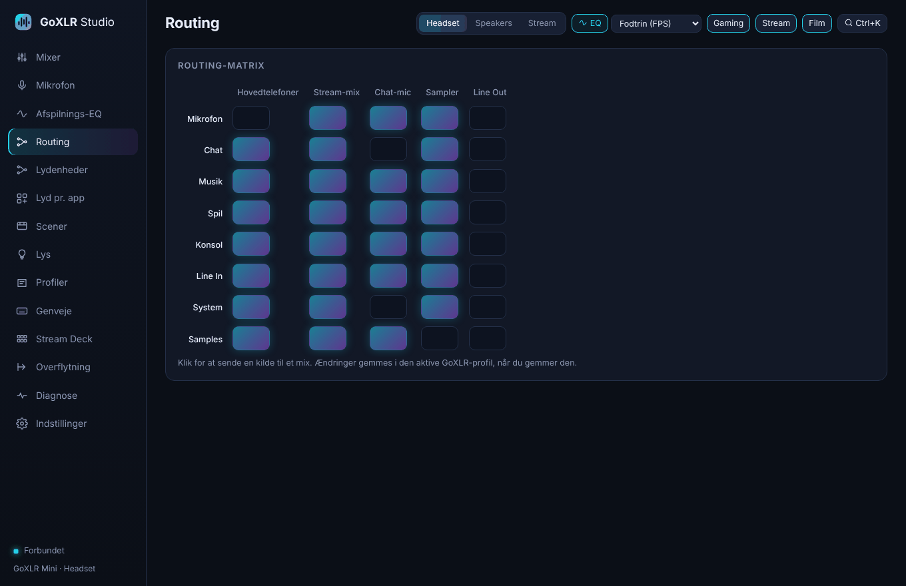

Hvilke kilder der går til hovedtelefoner, stream, chat-mic, sampler og line out – ét klik pr. felt.

### Overflytning fra de gamle programmer

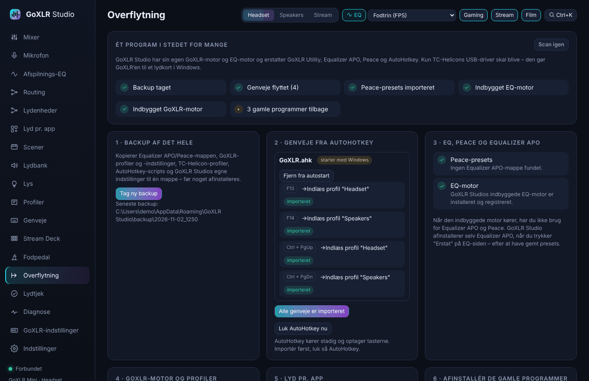

GoXLR Studio tager backup af det hele og henter dine AutoHotkey-genveje, Peace-presets og TC-Helicon-profiler. Det overtager fra GoXLR Utility og hjælper dig med at afinstallere de gamle programmer. Driveren bliver.

### Indstillinger, Discord og meget mere

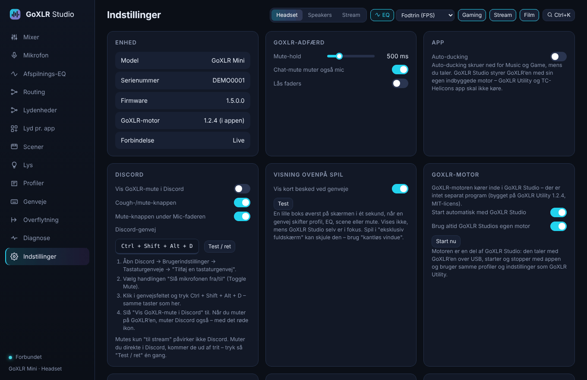

- **Discord:** GoXLR'ens mute-knap muter også Discord, med det røde ikon
- Auto-ducking, der skruer ned for musik og spil, mens du taler – eller mens vennerne taler i Discord
- **Høreværn:** påmindelse efter lang tid med høj lyd og et valgfrit loft for hovedtelefonerne
- **Profilhistorik:** tidligere versioner af dine GoXLR- og mikrofonprofiler kan gendannes
- Start med Windows og luk til bakke-ikonet
- Automatiske opdateringer
- **Home Assistant** via MQTT: GoXLR Studio dukker op som en enhed med mikrofon-mute, "Mikrofon åben" (fx til en ON AIR-lampe), GoXLR-profil, EQ-preset, scene og lydstyrker
- Lokalt API til fx Stream Deck
- **Lydtjek**, der finder Windows-indstillinger, som ændrer lyden (fx at Windows skruer ned for spillet under opkald), og retter dem med ét klik
- Dansk og engelsk: appen følger Windows' sprog og kan skiftes under Indstillinger
- Backup og en side med **Diagnose**, hvor du kan kopiere en rapport, hvis noget driller
- Effekter på den store GoXLR: reverb, echo, pitch, gender, megafon, robot og hardtune

*Billederne er taget med appens demo-data i GoXLR Mini-layout.*

## Indeholder

GoXLR Studio er MIT-licenseret. GoXLR Utility's motor (MIT) er bygget ind i selve appen, og Equalizer APO's lydmotor (GPL v2) bruges uændret – se [THIRD-PARTY-NOTICES.md](THIRD-PARTY-NOTICES.md).

## Udvikling

- UI: `public/` (vanilla JS, ingen build) – `STUDIO_PORT=14600 node server.js` kører den i en browser med demo-data (`?mini` for GoXLR Mini).
- GoXLR-motoren: `src-tauri/goxlr-engine/` (se dens README), EQ-motoren: `src-tauri/src/engine.rs`.
- Tests: `node --test tests/*.test.mjs` og `cd src-tauri && cargo test --lib`; `cargo check --target x86_64-pc-windows-msvc` tjekker Windows-delen.
- Windows-bygget sker i GitHub Actions; en ny version i `src-tauri/tauri.conf.json` på `main` udgives automatisk.
